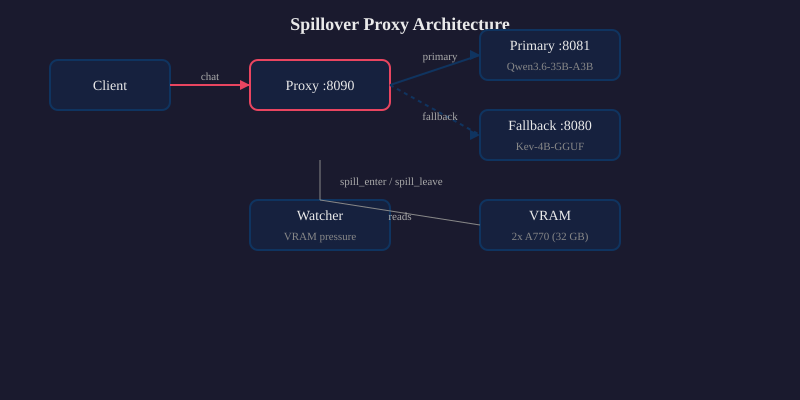
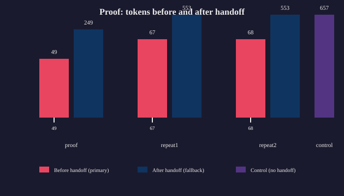

# The generation that didn't die

Token-level spillover for llama-server: when VRAM pressure crosses the line, the proxy replays the prefix into a fallback instance and keeps the client's connection open. The same session continues on a second model — no client-side change.

## Proof table

| Run | Tokens before handoff | Tokens after handoff | Total | Handoff latency | Fallback tok/s |
|-----|----------------------|----------------------|-------|-----------------|----------------|
| proof | 49 | 249 | 298 | 2.724s cold / 0.444s warm | 32.9 |
| repeat1 | 67 | 553 | 620 | 25.8s | 32.9 |
| repeat2 | 68 | 553 | 621 | 23.2s | 32.9 |
| control | — | — | 657 | 34.0s | — |

Handoff marks on proof chart: 49 / 67 / 68 tokens before fallback takes over.

## KV growth rate

0.000000 GB/1k tokens.

Measured during a 195-token streaming generation through the live proxy (2026-10-26). Watcher sampled VRAM at 1 Hz across 186 samples. VRAM was flat at 31336 MiB before, during, and after generation. The KV cache is preallocated at instance load; growth is instance-load jumps (+5041 MiB sidecar peak), not per-token growth.

## Static safe-settings run

Direct `:8081`, no proxy, no watcher.
- `max_tokens=100` (conservative static cap)
- prompt_tokens=57, completion_tokens=100, total_tokens=157
- finish_reason=length
- predicted_ms=5019.241, predicted_per_token_ms=50.70, predicted_per_second=19.72
- VRAM before/after: 31336 MiB (flat)

## Deployment

Live on `:8090`.
- Units active: `spillover-watcher.service`, `spillover-proxy.service`, `spillover-failopen.service`
- Battery-proven config: `--high-water 0.95 --low-water 0.85 --confirm 3`
- Fallback: `:8080` (Kev-4B-GGUF)
- Primary: `:8081` (Qwen3.6-35B-A3B main + Kev-4B draft)

## Split note

The proxy handles chat routes only (`/v1/chat/completions`). The Hermes local decision path (`/v1/systemone`) stays on `:8080` direct. Routing the decision path through the proxy would require a code change to add a `/v1/systemone` handler — that is a separate decision, not this job.

## Honest limits

- Re-prefill cost: the fallback receives the full emitted prefix. Mid-stream handoffs pay a 0.44–2.72s re-prefill penalty depending on cache warmness.
- Warm second instance needed: the fallback must be warm for acceptable latency. Cold starts are not acceptable in production.
- Post-handoff quality drops to Kev-4B: the fallback model is smaller. Output quality changes at the handoff point.
- Fallback context 8192 caps over-64k replays: long primary contexts cannot be fully replayed into the 8192-token fallback context. Over-64k inputs are infeasible with current fallback settings.
- Proven on 2x A770 only: validation is on Intel Arc A770 SYCL. Other GPUs/backends have not been tested.

## Architecture

## Proof chart

